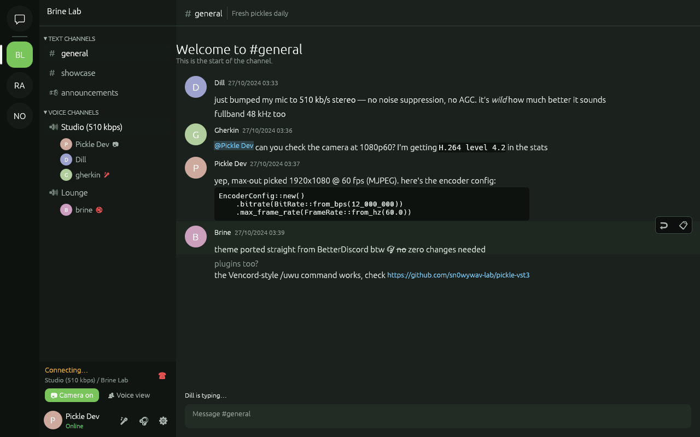
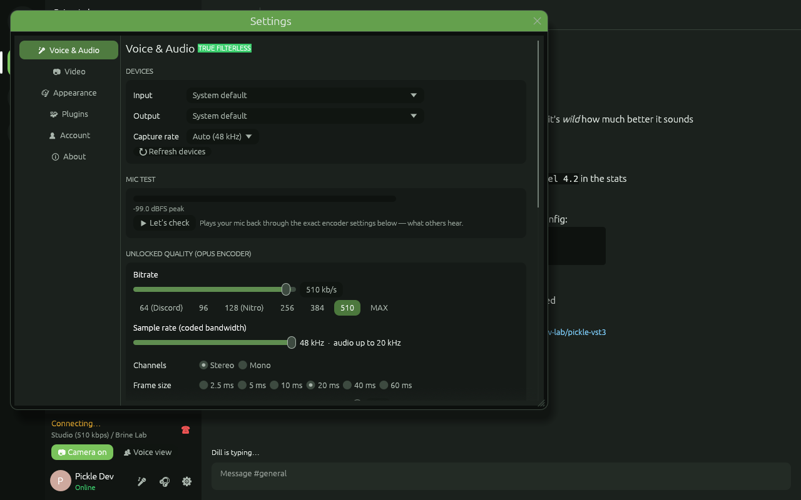
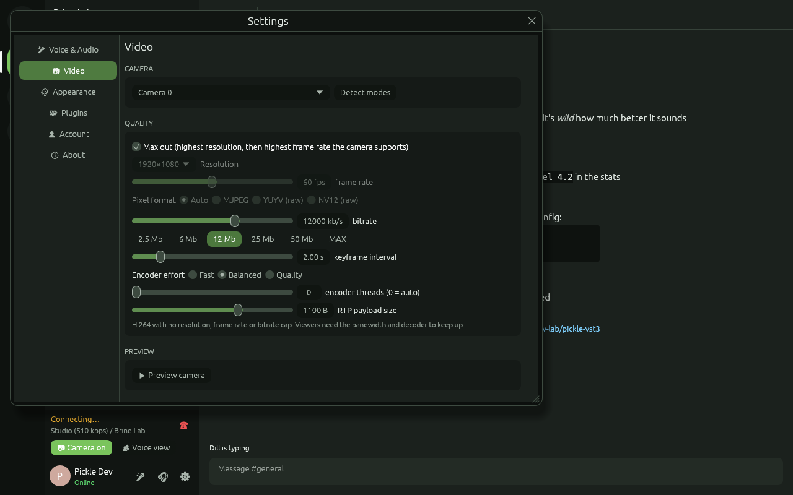
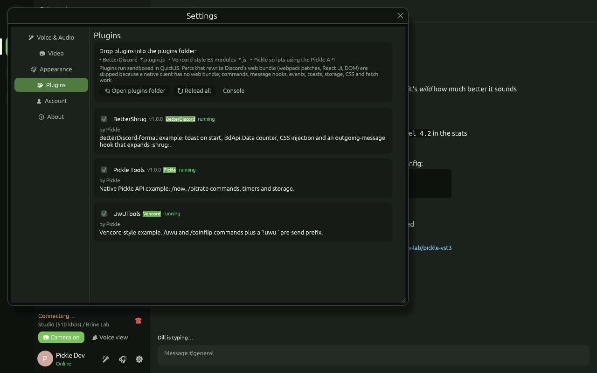

# Pickle: a native client for Discord, written in Rust

Pickle is a lightweight desktop client for Discord. It has no Electron and no web view: the UI is native Rust (egui on OpenGL), and voice and video run on dedicated real-time threads.

What makes it different:

- **Unlocked microphone quality.** You set the Opus bitrate (6–600 kb/s), the sample rate (8 / 12 / 16 / 24 / 48 kHz), stereo or mono, frame size, complexity, VBR, FEC and DTX.
- **No processing on your mic.** There is no noise suppression, echo cancellation, AGC, noise gate or high-pass filter in the audio path. With a 48 kHz mic and 0 dB gain, the encoder receives the exact samples your device produces.
- **Camera quality with no cap.** "Max out" uses your camera's highest resolution and then its highest frame rate. You can also choose the resolution, fps, pixel format, bitrate (up to 100 Mb/s), keyframe interval and encoder effort yourself.
- **Themes and plugins from other clients.** BetterDiscord `.theme.css` files and Vencord/Vesktop themes load directly. BetterDiscord `*.plugin.js` plugins and Vencord-style plugins run in a sandboxed JavaScript engine.

| Chat | Voice settings |
|---|---|
|  |  |
| **Video settings** | **Plugins** |
|  |  |

> **Read this first.** Third-party clients, and changing how your voice is encoded, are against Discord's Terms of Service, so using Pickle can get your account actioned. Pickle is an independent project, not affiliated with or endorsed by Discord. Use it at your own risk.

---

## Features

**Chat:** servers, categories, text/announcement/voice channels, DMs and group DMs, message history with infinite scroll, sending, replies, editing, deleting, typing indicators, unread dots and mention badges, Discord markdown (bold, italic, underline, strike, spoilers, inline code, code blocks, quotes, headings), mentions, custom emoji, timestamps, image attachments, embeds, plus `/shrug`, `/tableflip`, `/unflip` and `/spoiler`.

**Voice:**
- Join, leave, mute and deafen, with per-user volume up to 400% (right-click a user).
- Speaking rings and live stats: ping, actual bitrate, packet counts.
- Discord voice gateway v8, UDP with `aead_aes256_gcm_rtpsize` or `aead_xchacha20_poly1305_rtpsize`.
- **DAVE end-to-end encryption** (MLS) through [`davey`](https://crates.io/crates/davey). The privacy code is shown in the voice panel tooltip.
- Jitter buffer with packet-loss concealment, and a lock-free mixer.

**Video:**
- Webcam capture through V4L2, Media Foundation or AVFoundation.
- H.264 encoding with OpenH264 (compiled from source, so no system dependency), RTP FU-A packetization and DAVE frame encryption.
- Receives and decodes other people's cameras and shows them in a call grid with a mirrored self-preview.

## The voice settings, explained

Open **Settings → Voice & Audio**.

| Setting | Range | What it does |
|---|---|---|
| Bitrate | 6 – 600 kb/s | Opus target bitrate. Presets: 64 (Discord default), 128 (Nitro), 256, 384, 510, MAX. |
| Sample rate | 8 / 12 / 16 / 24 / 48 kHz | The coded bandwidth. 48 kHz is fullband: audio up to 20 kHz. |
| Channels | Stereo / Mono | Real stereo. The encoder is forced never to downmix. |
| Frame size | 2.5 – 60 ms | Smaller frames give lower latency, and 10 ms frames unlock the full 600 kb/s. |
| Complexity | 0 – 10 | Encoder effort. Default is 10. |
| Mode | Full fidelity / Low delay / Voice | The first two have no filtering. "Voice" is what Discord uses and adds Opus' speech high-pass filter. |
| VBR / constrained VBR, FEC + expected loss, DTX, phase inversion | | Every remaining Opus control. |
| Capture rate | Whatever your device supports | At 48 kHz the samples go straight to Opus with no resampling. |
| Input gain, voice gate | Off by default | Optional. Leave them off for an untouched signal. |
| Jitter buffer, output volume | | Playback side. |

Opus's hard limits apply: 300 kb/s per channel and 1275 bytes per frame. The panel shows the effective bitrate whenever your choice exceeds what the current frame size allows. Pick **MAX** to get stereo at 10 ms frames and 600 kb/s.

**Let's check** plays your mic back through the exact encoder settings, so you hear what other people hear.

## Themes from other clients

Put any `.css` file in the themes folder, or paste a URL into **Settings → Appearance → Import**.

| OS | Themes folder |
|---|---|
| Windows | `%APPDATA%\pickle\Pickle\config\themes` |
| macOS | `~/Library/Application Support/dev.pickle.Pickle/themes` |
| Linux | `~/.config/pickle/themes` |

What carries over from web-client themes:

- the `@name` / `@author` / `@description` header
- `@import url(...)` remote stylesheets, which are downloaded and applied
- the colour variables every theme defines on `:root`, `.theme-dark`, and so on, in both the classic names (`--background-primary`, `--text-normal`, `--brand-experiment`, …) and the newer ones (`--background-base-lower`, `--text-default`, `--text-strong`, …)
- `var()` with fallbacks, `calc()`, `hex` / `rgb()` / `hsl()` (comma or space syntax), `color-mix()`, named colours, gradients (the first colour is used)
- `--background-image: url(...)`
- `.theme-light` overrides, which are kept separate from dark ones

Selector rules that restyle specific HTML elements can't apply, because a native app has no HTML.

Pickle also reads a few extra variables: `--pickle-radius`, `--pickle-accent` and `--pickle-bg-*`.

See [`examples/themes/FrostedBrine.theme.css`](examples/themes/FrostedBrine.theme.css). The built-in themes are Pickle Dark, Midnight OLED, Graphite and Daylight.

## Plugins from other clients

Drop files into the plugins folder (next to `themes`) and enable them in **Settings → Plugins**. Each plugin runs in its own QuickJS context, with a 256 MB memory cap and a watchdog that stops a script after 2 s without yielding.

| Format | Example | What works |
|---|---|---|
| **BetterDiscord** `*.plugin.js` | [`BetterShrug.plugin.js`](examples/plugins/BetterShrug.plugin.js) | `module.exports = class {start, stop}` and factory forms, `new BdApi(name)` and the global `BdApi`: `UI.showToast/alert`, `Data.load/save/delete` (persistent), `DOM.addStyle/removeStyle` (CSS variables are applied to the theme), `Logger`, `Net.fetch`, legacy `loadData/saveData/injectCSS`, plus the `onMessage` and `onSwitch` hooks |
| **Vencord-style** ES module `*.js` | [`UwUTools.js`](examples/plugins/UwUTools.js) | `import definePlugin from "@utils/types"`, `@api/Commands` (`commands`, `findOption`, `sendBotMessage`), `@api/MessageEvents` (pre-send listeners), `@api/Settings`, `@utils/constants` (`Devs`), `@utils/Logger`, `@webpack/common` (`FluxDispatcher`, `Toasts`, stores), `flux` handlers, `start`/`stop` |
| **Pickle** script `*.js` | [`pickle-tools.js`](examples/plugins/pickle-tools.js) | the native API below |

Every plugin also gets `console`, `setTimeout`/`setInterval`, `fetch` and Promises.

**Native API:**

```js
Pickle.on("MESSAGE_CREATE", ({ message }) => {});   // also CHANNEL_SELECT, MESSAGE_DELETE, TYPING_START, VOICE_STATE_UPDATES
Pickle.onBeforeSend((channelId, msg) => { msg.content = msg.content.toUpperCase(); /* return { cancel: true } to block */ });
Pickle.commands.register({ name: "hi", description: "…", options: [{ name: "who" }], execute: (args, ctx) => ({ content: "hi " + args[0].value }) });
Pickle.sendMessage(channelId, "text");   Pickle.sendLocal(channelId, "only you see this");
Pickle.toast("saved!", "success");       Pickle.alert("Title", "Body");
Pickle.css.set("id", ":root { --brand-experiment: hotpink; }");
Pickle.storage.get(key, fallback);       Pickle.storage.set(key, value);
Pickle.context();                        // { me, channelId, guildId }
await Pickle.fetch(url, { method, body });
```

Typing `/` in the message box lists every built-in and plugin command.

**What can't work in any native client:** plugins that rewrite Discord's web bundle (webpack `patches`, `BdApi.Patcher`), render React components or touch the DOM. Those calls are stubbed out with a warning in the plugin console, so the plugin still loads and its other features keep working. TypeScript Vencord plugins (`.ts`/`.tsx`) need to be compiled to JavaScript first.

## Performance

**UI:**
- Repaints only when something changes, so an idle window uses roughly 0% CPU. During a call it refreshes at 30 fps for meters and video.
- The OpenGL renderer starts fast, and the allocator is `mimalloc`.
- Images are decoded off the UI thread, and the texture cache is capped.

**Gateway:**
- `zlib-stream` compression with a single inflater and reused buffers.
- Two-phase JSON parsing: only the envelope is parsed up front. Event types the client doesn't use are skipped without building a JSON tree.

**State:** the store lives on the UI thread, so there are no locks. Snowflakes are stored as 8-byte integers and message history is capped per channel.

**Audio:**
- The capture and playback callbacks are wait-free: they only touch lock-free SPSC ring buffers and allocate nothing. Encoding, mixing and network I/O run on their own threads.
- UDP goes over blocking std sockets on dedicated threads with 4 MB kernel buffers. Media never passes through the async runtime.

**Release builds:** fat LTO, `codegen-units = 1`, `opt-level = 3`, stripped.

## Building

You need Rust 1.88 or newer, and CMake. CMake builds the bundled libopus; OpenH264 and QuickJS are compiled with the C/C++ toolchain.

| OS | Setup |
|---|---|
| Windows | Install [Rust](https://rustup.rs), *Visual Studio Build Tools* (C++ workload) and [CMake](https://cmake.org/download/). |
| Linux (Debian/Ubuntu) | `sudo apt install build-essential cmake clang pkg-config libasound2-dev libv4l-dev libxkbcommon-dev libwayland-dev libgl-dev` |
| macOS | `xcode-select --install` and `brew install cmake` |

Then build and run:

```sh
cd pickle-client
cargo build --release          # binary: target/release/pickle(.exe)
cargo run --release
```

Optional:

- Build without webcam support: `cargo build --release --no-default-features`
- Try the UI offline, without logging in: `PICKLE_DEMO=1 cargo run`. Add `PICKLE_DEMO_SETTINGS=voice|video|appearance|plugins` to open a settings tab.
- Use a separate settings folder: `PICKLE_HOME=/some/dir`.

GitHub Actions builds Windows, Linux and macOS binaries on every push. Download them from the workflow run's artifacts.

### Logging in

Paste your account token on the first screen. Tick "Remember me" to keep it in `settings.json`, which is written with owner-only permissions on Unix. The token is only ever sent to `discord.com`. Images, theme imports and plugin `fetch` requests use a separate HTTP client that never carries the token.

## Project layout

```
pickle-client/
├── crates/
│   ├── pickle-discord   gateway (zlib-stream, resume, heartbeats), REST, data model, event-sourced store
│   ├── pickle-voice     Opus engine, resampler, jitter buffer/mixer, voice gateway v8, UDP + AEAD,
│   │                    DAVE E2EE, RTP/H.264 packetizer, camera capture, OpenH264 encode/decode
│   ├── pickle-themes    CSS parser: meta, @import, custom properties, var/calc/hsl/color-mix → palette
│   ├── pickle-plugins   QuickJS host with BdApi + Vencord module shims + native Pickle API
│   └── pickle-app       egui desktop app (the `pickle` binary)
└── examples/            example themes and plugins (all covered by tests)
```

Run the tests with `cargo test --workspace`. They cover:

- the zlib-stream inflater and gateway parsing
- the message store
- Opus stereo round-trips and bitrate caps
- the resampler's accuracy
- the jitter buffer and packet-loss concealment
- AEAD seal/open
- RTP and H.264 FU-A round-trips
- an **end-to-end encrypted UDP round-trip** of real Opus audio and a 1280×720 H.264 keyframe through a fake voice server
- theme parsing, including real BetterDiscord-style themes
- all three plugin formats, including the shipped examples, timers, fetch and the watchdog

The live connection to Discord itself needs an account, so the tests don't exercise it.
