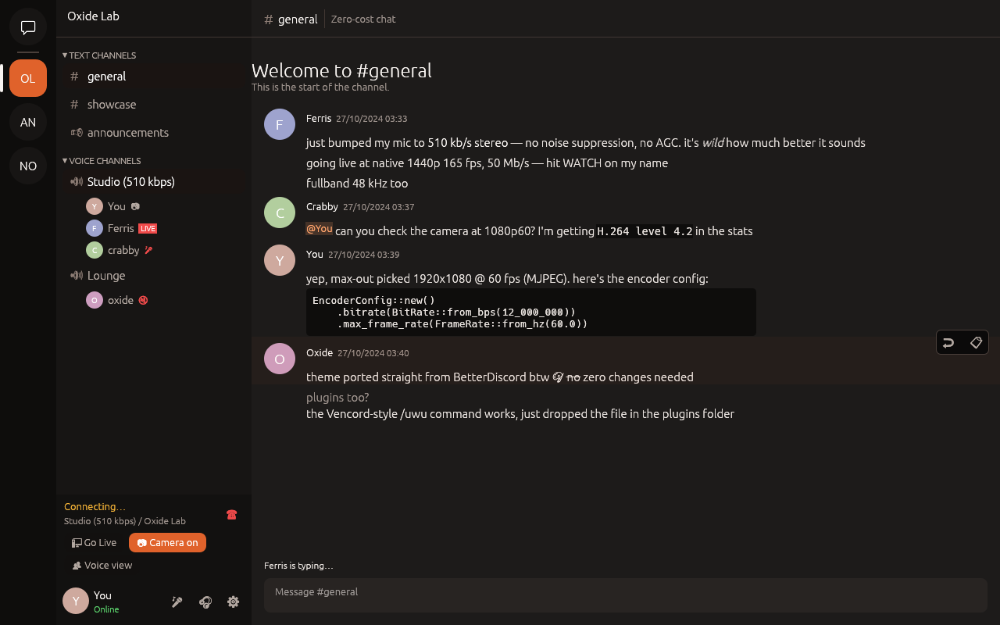
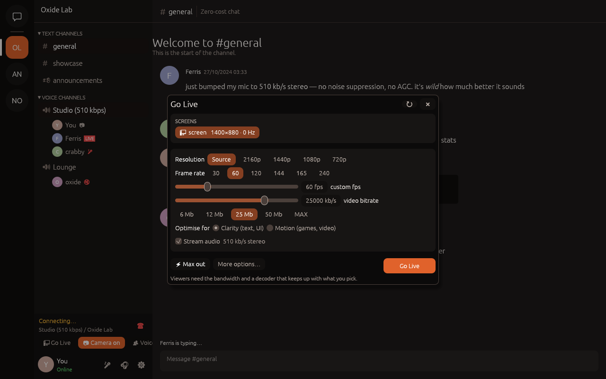
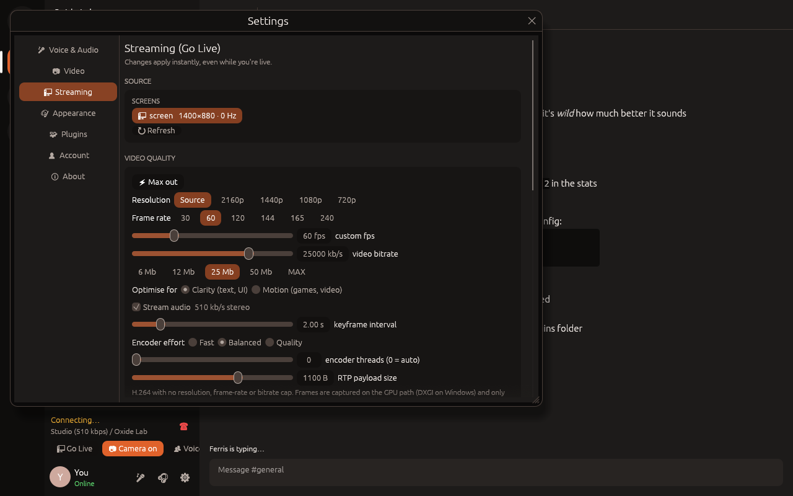
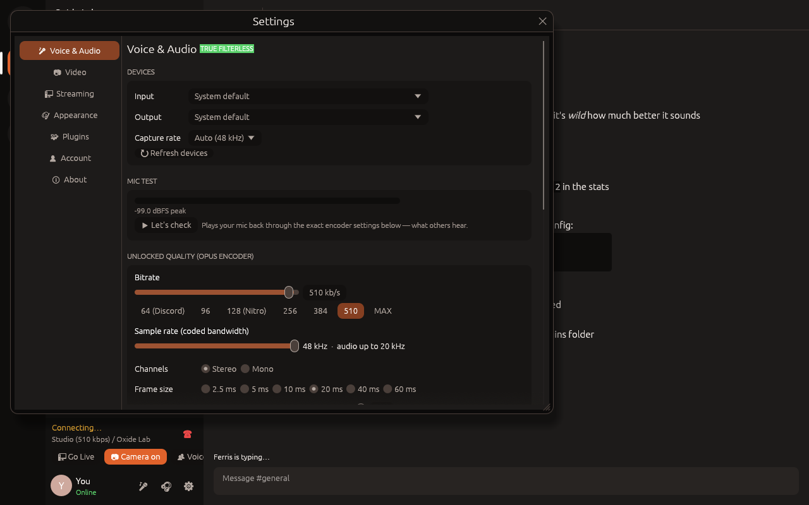

# Rustcord

Rustcord is a native client for Discord, written in Rust. It has no Electron and no web view: the UI is native egui on OpenGL, and audio, video and streaming run on dedicated real-time threads.

What it unlocks:

- **Microphone quality with no processing.**
  - Opus bitrate from 6 to 600 kb/s and sample rate from 8 to 48 kHz.
  - True stereo, plus frame size, complexity, VBR, FEC and DTX.
  - No noise suppression, echo cancellation, AGC, noise gate or high-pass filter anywhere in the audio path.
- **Uncapped camera.** "Max out" picks your camera's highest resolution, then its highest frame rate. The bitrate goes up to 100 Mb/s.
- **Uncapped Go Live.**
  - Stream a screen or a window at native resolution (or 2160p/1440p/1080p/720p) and up to 240 fps, at up to 100 Mb/s.
  - Stream audio is captured from the system mix and encoded at up to 510 kb/s stereo, using the same Opus controls as the mic.
  - You can watch other people's streams too.
- **Themes and plugins from other clients.** BetterDiscord and Vencord themes load directly. BetterDiscord `*.plugin.js` plugins and Vencord-style plugins run in a sandboxed JavaScript engine.

| Chat | Go Live |
|---|---|
|  |  |
| **Stream settings** | **Voice settings** |
|  |  |

> **Read this first.** Third-party clients, and changing how your voice or streams are encoded, are against Discord's Terms of Service, so using Rustcord can get your account actioned. Rustcord is an independent project and is not affiliated with Discord. Use it at your own risk.

---

## Features

**Chat:** servers, categories, text/announcement/voice channels, DMs and group DMs, history with infinite scroll, sending, replies, editing, deleting, typing indicators, unread and mention badges, Discord markdown (bold, italic, underline, strike, spoilers, code, code blocks, quotes, headings), mentions, custom emoji, timestamps, image attachments, embeds, plus `/shrug`, `/tableflip`, `/unflip` and `/spoiler`.

**Voice:** join, leave, mute and deafen; per-user volume up to 400% (right-click a user); speaking rings; live ping and bitrate. Built on voice gateway v8 and UDP with AES-256-GCM or XChaCha20 transport encryption, plus **DAVE end-to-end encryption** (MLS). A jitter buffer with loss concealment feeds a lock-free mixer.

**Camera:** capture through V4L2, Media Foundation or AVFoundation, encoded as H.264 (OpenH264, compiled from source). You see other people's cameras in a call grid.

**Go Live:**
- Stream a monitor or a window, with optional system audio.
- Click **LIVE** next to someone in a voice channel to watch their stream. Its picture appears in the call grid and its sound plays through your normal output.

## Voice settings (Settings → Voice & Audio)

| Setting | Range | Notes |
|---|---|---|
| Bitrate | 6 – 600 kb/s | Presets: 64 (Discord default), 128 (Nitro), 256, 384, 510, MAX. |
| Sample rate | 8 / 12 / 16 / 24 / 48 kHz | Opus coded bandwidth. 48 kHz carries audio up to 20 kHz. |
| Channels | Stereo / Mono | Real stereo; the encoder is never allowed to downmix. |
| Frame size | 2.5 – 60 ms | 10 ms frames unlock the full 600 kb/s. |
| Complexity | 0 – 10 | Default 10. |
| Mode | Full fidelity / Low delay / Voice | The first two apply no filtering. "Voice" (what Discord uses) adds Opus' speech high-pass filter. |
| VBR, constrained VBR, FEC and expected loss, DTX, phase inversion | | Every remaining Opus control. |
| Capture rate | Whatever the device supports | At 48 kHz the samples go to Opus untouched. |
| Input gain, voice gate | Off by default | Optional. |

Opus's own limits still apply: 300 kb/s per channel and 1275 bytes per frame. The panel shows the effective bitrate whenever your choice exceeds them. **Let's check** plays your mic back through the exact encoder settings.

## Stream settings (Go Live button or Settings → Streaming)

| Setting | Range | Notes |
|---|---|---|
| Source | Any monitor or window | Monitors use push-based capture (DXGI Desktop Duplication on Windows, ScreenCaptureKit on macOS, PipeWire/X11 on Linux). |
| Resolution | Source, 2160p, 1440p, 1080p, 720p | Downscaling uses an area-average filter so text stays sharp. |
| Frame rate | 1 – 240 fps | Presets: 30, 60, 120, 144, 165, 240. |
| Video bitrate | 0.5 – 100 Mb/s | |
| Optimise for | Clarity / Motion | Clarity uses OpenH264's screen-content mode for text and UI; Motion is for games and video. |
| Keyframe interval, encoder effort, threads, RTP payload size | | |
| Stream audio | On/off, device | Captures the system mix (WASAPI loopback on Windows) or any input. On Linux/macOS, pick a monitor or loopback device such as BlackHole. |
| Stream audio quality | Every Opus control | Same controls as the mic. Defaults to 510 kb/s stereo, 48 kHz, no filtering. |

**⚡ Max out** sets native resolution, your screen's refresh rate, 50 Mb/s, the best encoder effort and 510 kb/s stereo audio.

Settings apply live while you're streaming. Only the newest captured frame is ever encoded, so an overloaded CPU drops frames instead of building up delay. Your viewers need the bandwidth and a decoder that can keep up with what you pick.

## Themes from other clients

Put any `.css` file in the themes folder, or paste a URL into **Settings → Appearance → Import**.

| OS | Themes folder |
|---|---|
| Windows | `%APPDATA%\rustcord\Rustcord\config\themes` |
| macOS | `~/Library/Application Support/dev.rustcord.Rustcord/themes` |
| Linux | `~/.config/rustcord/themes` |

What carries over:

- the `@name` / `@author` header
- remote `@import`s, which are downloaded and applied
- the colour variables themes define, both the classic names (`--background-primary`, `--text-normal`, `--brand-experiment`, …) and the newer ones (`--background-base-lower`, `--text-default`, …)
- `var()`, `calc()`, `rgb`/`hsl` in both syntaxes, `color-mix()`, named colours, gradients
- `--background-image`
- `.theme-light` overrides, kept separate from dark ones

Selector rules for specific HTML elements can't apply in a native app.

Rustcord-only variables: `--rustcord-radius`, `--rustcord-accent`, `--rustcord-bg-*`.

The built-in themes are Rustcord Dark (default), Midnight OLED, Graphite and Daylight. There is an example in [`examples/themes/FrostedSteel.theme.css`](examples/themes/FrostedSteel.theme.css).

## Plugins from other clients

Drop files into the plugins folder (next to `themes`) and enable them in **Settings → Plugins**. Each plugin gets its own QuickJS context with a 256 MB cap and a 2 s runaway-script watchdog.

| Format | Example | What works |
|---|---|---|
| **BetterDiscord** `*.plugin.js` | [`BetterShrug.plugin.js`](examples/plugins/BetterShrug.plugin.js) | class/factory exports, `new BdApi(name)` and the global `BdApi`: `UI.showToast/alert`, `Data` (persistent), `DOM.addStyle` (CSS variables are applied to the theme), `Logger`, `Net.fetch`, legacy `loadData/saveData/injectCSS`, `onMessage`, `onSwitch` |
| **Vencord-style** ES modules `*.js` | [`UwUTools.js`](examples/plugins/UwUTools.js) | `@utils/types`, `@api/Commands`, `@api/MessageEvents`, `@api/Settings`, `@utils/constants`, `@utils/Logger`, `@webpack/common` (`FluxDispatcher`, `Toasts`, stores), `commands`, `flux`, `start`/`stop` |
| **Rustcord** scripts `*.js` | [`rustcord-tools.js`](examples/plugins/rustcord-tools.js) | the native API below |

Every plugin also gets `console`, `setTimeout`/`setInterval`, `fetch` and Promises.

**Native API:**

```js
Rustcord.on("MESSAGE_CREATE", ({ message }) => {});   // also CHANNEL_SELECT, MESSAGE_DELETE, TYPING_START, VOICE_STATE_UPDATES
Rustcord.onBeforeSend((channelId, msg) => { msg.content = msg.content.toUpperCase(); /* or return { cancel: true } */ });
Rustcord.commands.register({ name: "hi", options: [{ name: "who" }], execute: (args, ctx) => ({ content: "hi " + args[0].value }) });
Rustcord.sendMessage(channelId, "text");   Rustcord.sendLocal(channelId, "only you see this");
Rustcord.toast("saved!", "success");       Rustcord.alert("Title", "Body");
Rustcord.css.set("id", ":root { --brand-experiment: hotpink; }");
Rustcord.storage.get(key, fallback);       Rustcord.storage.set(key, value);
Rustcord.context();                        // { me, channelId, guildId }
await Rustcord.fetch(url, { method, body });
```

**What can't work in any native client:** webpack `patches`, `BdApi.Patcher`, React components and the DOM. Those calls are stubbed with a warning in the plugin console, so the rest of the plugin still runs. TypeScript plugins must be compiled to JavaScript first.

## Performance

**UI:** repaints only on change, so it uses about 0% CPU while idle. During calls it refreshes at 30 fps for meters and video. The message list is virtualised: only rows near the viewport are laid out, using cached heights. The renderer is OpenGL and the allocator is `mimalloc`. Images are decoded off the UI thread into a capped texture cache.

**Gateway:** `zlib-stream` with a single inflater and reused buffers, plus two-phase JSON parsing so event types Rustcord doesn't use are skipped without building a JSON tree.

**State:** the store lives on the UI thread, so it needs no locks.

**Audio:** the capture and playback callbacks are wait-free and allocate nothing. They only touch lock-free SPSC ring buffers.

**Media transport:** media never goes through the async runtime. It uses blocking UDP sockets on dedicated threads with 4 MB kernel buffers, so large keyframes aren't dropped by the OS.

**Release builds:** fat LTO, `codegen-units = 1`, `opt-level = 3`, stripped.

## Building

You need Rust 1.88 or newer and CMake.

| OS | Setup |
|---|---|
| Windows | Install [Rust](https://rustup.rs), Visual Studio Build Tools (C++ workload) and [CMake](https://cmake.org/download/). |
| Linux (Debian/Ubuntu) | `sudo apt install build-essential cmake clang pkg-config libasound2-dev libv4l-dev libxkbcommon-dev libwayland-dev libgl-dev libpipewire-0.3-dev libspa-0.2-dev libxcb1-dev libxcb-randr0-dev libxcb-shm0-dev libdbus-1-dev libgbm-dev libegl-dev` |
| macOS | `xcode-select --install && brew install cmake` |

```sh
cd rustcord
cargo build --release          # → target/release/rustcord(.exe)
cargo run --release
```

Optional switches:

- Leave out the webcam or screen capture: `--no-default-features`, or `--no-default-features --features camera`.
- Try the UI offline: `RUSTCORD_DEMO=1 cargo run`.
  - Add `RUSTCORD_DEMO_SETTINGS=voice|video|streaming|appearance|plugins` to open a settings tab.
  - Add `RUSTCORD_DEMO_GOLIVE=1` to open the Go Live picker.
- Use a separate settings folder: `RUSTCORD_HOME=/some/dir`.

GitHub Actions builds Windows, Linux and macOS binaries on every push. Download them from the workflow run's artifacts.

**Logging in:** paste your account token. Tick "Remember me" to store it in `settings.json`, which is owner-only on Unix. The token is only ever sent to `discord.com`. Images, theme imports and plugin requests use a separate HTTP client without it.

## Project layout

```
rustcord/
├── crates/
│   ├── rustcord-discord   gateway (zlib-stream, resume, Go Live ops), REST, model, event-sourced store
│   ├── rustcord-voice     Opus engine + resampler + mixer, voice gateway v8, UDP + AEAD, DAVE E2EE,
│   │                      RTP/H.264, camera capture, screen capture, OpenH264 encode/decode
│   ├── rustcord-themes    CSS → palette (meta, @import, custom properties, var/calc/hsl/color-mix)
│   ├── rustcord-plugins   QuickJS host: BdApi + Vencord module shims + native Rustcord API
│   └── rustcord-app       the egui desktop app (`rustcord` binary)
└── examples/              example themes and plugins (covered by tests)
```

`cargo test --workspace` runs 54 tests. They cover:

- gateway inflate and parsing, including the Go Live payloads
- the message store
- Opus stereo round-trips and bitrate caps
- resampler accuracy
- the jitter buffer and loss concealment
- AEAD encryption
- RTP and H.264 FU-A
- an **end-to-end encrypted UDP round-trip** of real Opus audio and a 720p H.264 keyframe through a fake voice server
- RGBA box downscaling
- stream output sizing
- theme parsing
- all three plugin formats

`DISPLAY=… cargo test -p rustcord-voice -- --ignored` also captures a real desktop, encodes it in screen-content mode and decodes it again.

The live connection to Discord needs an account, so the tests don't exercise it.
